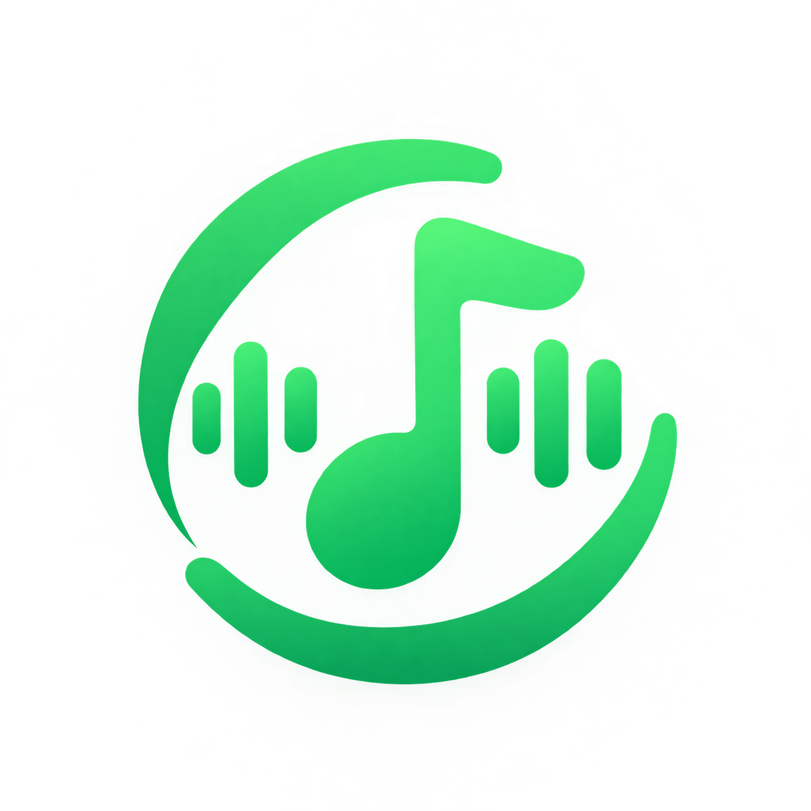

<div align="center">

# Lunara for iOS



### A modern music player built in SwiftUI

Stream, download, and play local audio with word-by-word synced lyrics
and a multi-band equalizer.

<br />

[](#building)
[](#technology)
[](#technology)
[](project.yml)
[](LICENSE)

[](codemagic.yaml)
[](.github/workflows/release-ipa.yml)
[](#distribution)

<br />

[Overview](#overview) &nbsp;|&nbsp; [Features](#features) &nbsp;|&nbsp; [Building](#building) &nbsp;|&nbsp; [Distribution](#distribution) &nbsp;|&nbsp; [Technology](#technology)

</div>

---

## Table of Contents

- [Overview](#overview)
- [Features](#features)
- [Building](#building)
- [Distribution](#distribution)
- [Technology](#technology)
- [License](#license)
- [Author](#author)

---

## Overview

Lunara streams music seamlessly, plays local audio files on your phone, and tracks synced lyrics with word-by-word highlighting.

## Features

### Playback and Audio

| Feature | Description |
|---------|-------------|
| **Streaming** | Search and browse songs, albums, artists, mood stations, and playlists. |
| **Local music** | Import audio from Files and play it alongside streamed tracks. |
| **Downloads and audio cache** | Keep songs offline and cache streamed playback automatically. |
| **Queue** | Reorder tracks, save the queue as a playlist, or launch radio from any track. |
| **Equalizer** | Multi-band DSP equalizer with presets. |
| **Background audio and lock screen** | Full media controls, sleep timer, and AirPlay support. |
| **Stream sources** | Select preferred playback stream clients and audio quality. |

### Lyrics

| Feature | Description |
|---------|-------------|
| **Synced lyrics** | Word-by-word highlighting and TTML timing support. |
| **Romanization and AI translation** | Optional script romanization and translations. |
| **Lyrics cache** | Cached locally for offline reading. |

### Library and Extras

| Feature | Description |
|---------|-------------|
| **Local library and playlists** | Create and manage playlists, liked songs, and favorite artists on device. |
| **Import from Spotify** | Match public Spotify playlists track by track into local playlists. |
| **Share playlists and tracks** | Shareable artwork cards with scannable links. |
| **Home Screen widget and Siri Intents** | Quick playback widget and voice shortcuts. |

## Building

The Xcode project is generated with [XcodeGen](https://github.com/yonaskolb/XcodeGen) from [`project.yml`](project.yml).

```bash
brew install xcodegen
xcodegen generate
open LunaraPlayer.xcodeproj
```

### Project details

| Property | Value |
|----------|-------|
| **Language** | Swift |
| **UI** | SwiftUI |
| **Minimum OS** | iOS 17.0 |
| **Project generation** | XcodeGen from `project.yml` |
| **Bundle ID** | `com.lunara.player` |
| **Build output** | `LunaraPlayer.ipa` |

## Distribution

Two build pipelines are provided. Choose based on whether you have an Apple Developer membership.

### Option 1: Codemagic (signed, App Store)

[`codemagic.yaml`](codemagic.yaml) defines the `ios-release` workflow, which creates an App Store-signed IPA.

1. Create an `app_store_credentials` environment group.
2. Add an App Store Connect API key and signing access to it.
3. Run the `ios-release` workflow.

The resulting build can be distributed through TestFlight or the App Store.

> [!NOTE]
> An IPA alone cannot be installed on arbitrary iPhones without Apple distribution or TestFlight.

### Option 2: GitHub Actions (unsigned, free)

[`release-ipa.yml`](.github/workflows/release-ipa.yml) builds entirely on GitHub-hosted runners and needs no Apple Developer secrets.

1. Open **Actions > Build and Release Unsigned IPA > Run workflow**.
2. Provide the version and build number.
3. The workflow generates the Xcode project on a macOS runner, packages an unsigned IPA, and attaches it to a GitHub Release.

### Installing the unsigned IPA

An unsigned IPA cannot be installed directly on an iPhone. For personal free use, download the release IPA and sign it with your own Apple ID using a sideloading tool.

| Tool | Notes |
|------|-------|
| **AltStore** | Signs with your Apple ID and refreshes through a companion app. |
| **SideStore** | On-device sideloading alternative. |
| **Sideloadly** | Desktop-based signing and installation. |

> [!IMPORTANT]
> Free Apple ID signing is limited by Apple and typically expires after seven days. Recent iOS versions may require Developer Mode for development-signed apps. A paid Apple Developer membership is only needed for longer-lived TestFlight or App Store distribution.

## Technology

| Area | Choice |
|------|--------|
| Language | Swift |
| UI framework | SwiftUI |
| Project generation | XcodeGen |
| Audio | Background playback, multi-band DSP equalizer, AirPlay |
| Integrations | Siri Intents, Home Screen widget |
| CI / CD | Codemagic, GitHub Actions |

## License

Released under the [GNU General Public License v3.0](LICENSE).

## Author

Designed and developed by **Ankit**, a BSc CSIT student and full-stack developer based in Kathmandu, Nepal.

[](https://github.com/ankitkhatrik6)
[](https://ankitkhatri.me)
[](https://instagram.com/21ank1t)

---

<div align="center">

Built with SwiftUI.

</div>
